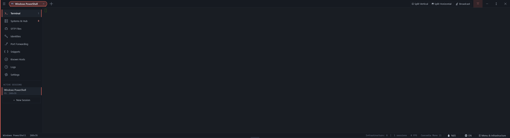

<p align="center">
  
</p>

<h1 align="center">FullTerminal</h1>

<p align="center">
  <b>Native Windows Terminal, SSH/SFTP Hub, Database & SQL Workspace</b><br>
  <i>Built with Pure C++20, Direct2D Hardware Acceleration, and Zero Web Bloatware.</i>
</p>

<p align="center">
  
  
  
  
  <a href="https://github.com/geataa/FullTerminal/releases/tag/v1.1.1"></a>
  
</p>

<p align="center">
  
</p>

---

## ⚡ Overview

**FullTerminal** is a single-binary native Windows terminal emulator, remote server manager (SSH / SFTP), database and SQL workspace, and local AI agent workspace.

Engineered in **C++20** with hardware-accelerated **Direct2D / DirectWrite** text rendering on D3D11/DirectComposition, FullTerminal provides native terminal, infrastructure and agent workflows without a web runtime. Input latency has not been measured across supported Windows environments.

> [!NOTE]
> **Portable application**: Run `FullTerminal.exe` from a writable folder. Settings live in the adjacent `portable_data` directory. Windows system libraries and installed OpenSSH, WSL, Docker or kubectl are required for their respective features. DPAPI-encrypted credentials and MCP tokens are tied to the Windows user; copying the folder to another computer does not migrate those secrets.

---

## What's new in 1.1.1

* **Built-in database clients**: PostgreSQL, MySQL/MariaDB and SQL Server connect through statically linked libraries in `FullTerminal.exe`, without installing a vendor ODBC driver. No database server is installed. SQLite remains embedded.
* **Native connection handling**: certificate verification, optional PEM CA files, metadata, parameterized CRUD, transactions/savepoints, cancellation and explicit reconnect. Each connection keeps its own main tab with SQL/table subtabs.
* **Validation**: 20 Windows regression suites and live PostgreSQL checks. MySQL/MariaDB and SQL Server still require live-server validation; see the release notes for authentication and cancellation limits.
* **Reproducible distribution**: pinned client source archives, license notices and rebuild/relink sources are included. The executable name remains `FullTerminal.exe`.

Download [FullTerminal 1.1.1](https://github.com/geataa/FullTerminal/releases/tag/v1.1.1). The executable is always named **`FullTerminal.exe`**. Read the [release notes](docs/releases/v1.1.1.md) for validation and supported scope.

## Development story: Claude → Antigravity → Codex

FullTerminal is proudly built through **Vibe Coding**—a pair-programming collaboration between human engineering direction and frontier AI:

* **Human Vision & Direction**: System architecture, Win32 message loop design, ergonomic UX, feature specifications, and real-time debugging led by **[@geataa](https://github.com/geataa)**.
* **Initial architecture — [Claude](https://github.com/claude)**: Claude established the project's initial architecture and technical foundation.
* **Continued development — Antigravity**: Antigravity built on that architecture and continued the terminal, rendering, infrastructure and localization work.
* **1.1.0 continuation — OpenAI Codex**: Codex took over where Antigravity left off, reviewed the existing architecture, fixed terminal/theme, SSH, SFTP and session bugs, and added the native database and SQL workspace. Regression tests and release packaging were expanded alongside these changes.

### 🛠️ Work in Progress & Active Polish
FullTerminal was built rapidly and passionately. While the core engines are backed by deterministic unit tests (covering VT parsing, color synchronization, OSC semantics, session serialization, and i18n), **not every single edge case across all Windows environments has been battle-tested yet**. 

We believe in radical honesty: you might run into quirks or undiscovered bugs! We are actively dogfooding FullTerminal daily, and bugs will be identified, patched, and deployed rapidly. If you spot anything strange, please open an issue or drop us feedback!

---

## 🌟 Key Features

### 🚀 Direct2D GPU Text Rendering Engine
* **Hardware-Accelerated**: Direct3D 11 & Direct2D pipeline with DirectWrite typography, subpixel anti-aliasing, and vsync display synchronization.
* **Standards Compliant**: VT100 / VT220 / xterm-256color and truecolor (24-bit RGB) ANSI support.
* **Semantic Shell Integration (OSC 133)**: Recognizes command boundaries, execution status, and enables instant semantic navigation (`Ctrl+Shift+Up` / `Down`).
* **Interactive Hyperlinks (OSC 8)**: Autodetects URLs and supports explicit OSC 8 links (`Ctrl+Click` to open directly in your default browser).

### 🪟 Dynamic Tiling Split Panes (Herdr Architecture)
* Split any terminal tab vertically (`Ctrl+Shift+D`) or horizontally (`Ctrl+Shift+E`).
* Re-tile, zoom any pane to full-canvas (`Ctrl+Shift+Z`), and switch focus smoothly (`Ctrl+Alt+Arrows`).
* Full tab title customization and renaming modal with backdrop dismissal and complete text selection (`Ctrl+A`, caret positioning).

### 👻 Desktop Transparency & Opacity Control
* Adjustable terminal canvas opacity from **10% to 100%** in normal, maximized and Quake/Visor windows, including application-drawn terminal backgrounds. Text and the cursor remain opaque.
* Smart overlay isolation: SFTP screens, settings modals, and dialogs remain crisp and readable while terminal viewports remain transparent.
* Window-mode changes preserve live terminal output, ANSI color state and application-controlled cursor visibility.
* Double-click a terminal token to select and copy everything up to whitespace, including punctuation and soft-wrapped continuations. Use Shift+double-click when a terminal application captures mouse input.

### 🎮 Quake / Visor Drop-Down Console
* Summon and dismiss FullTerminal from the top of the monitor using a global hotkey (default: `F12`, customizable with conflict detection).
* Smooth slide-down and pull-up animations, taskbar-independent operation, and interactive bottom resizing grip.

### 🌐 SSH Infrastructure Hub & Stage Loading
* Visual SSH host inventory with jump host (proxy jump) support, tag filtering, and identity management.
* SSH connection status with an unmodified terminal stream: login prompts, MOTD, colors and cursor movement use the same VT parser as live output. OpenSSH runs without verbose debug output.

### 📁 Dual-Pane SFTP File Explorer
* Built-in remote file management alongside active shell sessions.
* Browse remote directories, upload, download, rename, and preview remote files with a single click.

### Databases and SQL workspaces

Open **Databases** in the sidebar or **+ → Databases / SQL**. Each main tab owns one connection; table views and SQL scripts open as its child tabs. SQL work never goes through a terminal or MCP terminal-input endpoint.

* **SQLite** is compiled into `FullTerminal.exe`. Open/create a file or use `:memory:`.
* **PostgreSQL, MySQL/MariaDB and SQL Server** connect using client libraries statically linked into `FullTerminal.exe`: libpq 18.6, MariaDB Connector/C 3.4.11 and FreeTDS 1.5.19. No database server or vendor DLL/ODBC driver is installed. Existing engine profiles automatically use the native adapter; driver/DSN fields are only used by **generic ODBC**, which remains an optional externally installed driver path. Oracle is excluded from the built-in engines.
* TLS is required and certificate verification is enabled by default. Windows trusted roots are used, or select a PEM CA file. Trusting an unverified certificate is an explicit connection option. Servers without TLS require explicitly disabling encryption; the app never silently retries without it.
* Native MySQL authentication includes `mysql_native_password`, `caching_sha2_password` and `sha256_password`. External auth plugins (Ed25519, PARSEC, GSSAPI) are not bundled. SQL Server supports database credentials and Windows authentication through FreeTDS/SSPI; integrated authentication still depends on server/domain configuration.
* Browse databases, schemas, tables and views. Opening another server database creates a separate connection tab. Table structure shows types, nullability and primary keys; server-side paging, column-header sorting and exact-value/NULL filters run on the server. Generic ODBC supports a bounded first page; pagination requires a supported dialect.
* SQL editor: highlighting, selection, copy/paste, undo/redo, horizontal cursor tracking, open/save UTF-8 `.sql` files, in-memory history and multiple result sets. **F5** executes the script; **Ctrl+Enter** executes selected text or the full script; **Escape** cancels a running operation. **Ctrl+N/O/S** opens a child editor/loads/saves SQL. Statements are passed to the engine, including DDL, procedures and administration commands allowed by the database account. Client directives such as `GO`, `DELIMITER`, psql backslash commands and SQL*Plus commands are not SQL statements and are not expanded.
* Table CRUD binds values as parameters and quotes identifiers for the engine. Inserts distinguish DEFAULT, NULL and empty text. Updates/deletes require a primary key, compare original values and roll back if exactly one affected row cannot be verified. Binary/truncated rows are not editable in the grid. Some engine types (for example PostgreSQL `json` equality) require explicit SQL instead.
* Auto-commit and manual transactions; commit/rollback controls; grid changes use a savepoint inside an existing transaction. SQL `BEGIN`/`COMMIT`/`ROLLBACK` are tracked as well. Engine-specific transaction/session-control extensions may require an explicit reconnect to resynchronize state.
* Export **fetched results** as CSV/JSON, copy rows/cells, or display a numeric bar chart. Results are bounded to 1,000 rows per SQL result / 200 per table page, 32 result sets and approximately 16 MiB per operation. A truncated value is display-only; exports are not whole-database backups.
* An owned worker serializes each connection's operations; other tabs stay responsive. Idle connections are checked every 30 seconds outside transactions. A failure retains SQL and results, marks the connection lost and requires explicit reconnect; interrupted writes are never automatically replayed. Native query/login deadlines are 30/10 seconds. PostgreSQL cancellation preserves the connection; cancelling a MySQL operation closes its socket and requires reconnect. Generic ODBC timeout/cancellation behavior depends on its driver.
* Saved passwords use Windows DPAPI in `portable_data/databases.json`. SQL history/drafts are held in memory unless explicitly saved. Restored database tabs start disconnected. Closing a connection with drafts or an open transaction asks before discarding/rolling back. PostgreSQL/MySQL read-only sessions request the server transaction setting. SQL Server requires a login with read-only grants; its application-intent flag is not presented as permission enforcement. Use a restricted server account for security enforcement.

This is a native C++ database workspace. ER diagrams, visual schema/role designers, backup/restore and CSV import wizards, SQL completion and engine-specific administration panels are not implemented; the SQL editor supports the corresponding server SQL where applicable.

Validation on 2026-10-13: 20 local regression suites passed. The native PostgreSQL adapter was exercised against an existing PostgreSQL server: authentication, metadata/primary keys/generated columns, temporary-table CRUD, Unicode/NULL/empty values, decimals, row limits, multiple results, stale-edit rollback, transactions, cancellation and reconnect. MySQL/MariaDB and SQL Server passed compilation and no-driver failure-path tests but have **not** been validated against live instances in this change. No database servers were installed.

`test_database_odbc.exe <path-to-podbc35w.dll> <localhost-port>` is an opt-in integration fixture for a disposable `ft_test` PostgreSQL database; see the fixture source for its test-only credentials. It creates test tables. The driver is extracted into the build tree and registered only in the test process using a redirected registry hive. `test_database_ui.exe --wsl` verifies the + and Hub launch paths against installed WSL distributions, including docker-desktop, using isolated test terminal sessions.

### 📡 Broadcast Input Mode (`Ctrl+Shift+I`)
* Mirror keystrokes and shell commands across panes in the **active tab**.

### 🔄 Persistent Terminal Processes
* Enable **Settings → Restore sessions** to keep terminal processes in a separate `FullTerminal.exe --daemon` process when the GUI exits and reconnect to them on reopening.
* Closing a pane or tab still terminates that session. With restoration disabled, exiting the GUI closes its sessions.
* Reattach restores up to **256 KiB of recent terminal output**; it is not an unlimited scrollback snapshot. Windows restart ends the processes, so reopening starts replacement shells. Tray/Guake hiding continues to keep the GUI running.

### 📹 Session Recording & Built-in Replayer
* Record live terminal sessions into ultra-compact binary `.ftrec` files or universal Asciinema `.cast` format.
* Open recordings from **Logs → Recordings**, or run `FullTerminal.exe --replay "recording.cast"`. Playback supports pause, restart, seeking and 0.25×–4× speed for `.ftrec` and Asciinema v2 `.cast` files.

### 🌍 16-Language Native Internationalization (i18n)
* 16 selectable language catalogs; newer replay and HTTP controls currently use English/Turkish text.
* **Supported Languages**: English, Turkish, German, French, Spanish, Italian, Portuguese, Dutch, Polish, Hindi, Russian, Ukrainian, Japanese, Korean, Simplified Chinese, Arabic.
* Instant 1-click on-the-fly language cycling without restarting the application.

### ☸️ Kubernetes YAML & Command Snippets
* Integrated snippet and manifest manager.
* 1-click `kubectl apply -f -` pipe to stream YAML manifests directly into the active cluster terminal.

### 🤖 Model Context Protocol (MCP) Bridge & Agent Fleet
* Exposes **11 tools**, including systems, command execution, files, vault, pane management, swarm creation and recording. Tool visibility follows configured permissions.
* Supports stdio (`--mcp`) and authenticated loopback Streamable HTTP at `http://127.0.0.1:8787/mcp` (configurable port). Enable MCP and the transport in Settings, generate a token, then copy the connection configuration. HTTP uses stateless JSON responses; no SSE subscription is provided.
* The GUI manages its HTTP process; it stops when the GUI exits. Headless use is available through `FullTerminal.exe --mcp-http`. This is an MCP **server**; connecting to arbitrary external MCP servers as a client is not implemented.
* Interactive Agent Approval Ribbon with live approval/denial controls (`Ctrl+Shift+Y` / `Ctrl+Shift+N`) and audit logging.
* Details: [MCP guide](docs/05-MCP-REHBERI.md), [verified implementation and limits](docs/06-MEVCUT-DURUM-VE-BUGFIX-HARITASI.md).

---

## 💡 Open Source Inspirations

FullTerminal was deeply inspired by the pioneers of modern, open-source terminal engineering. We pay homage to these incredible open-source projects:

* **[Alacritty](https://github.com/alacritty/alacritty)** *(Apache-2.0)* - Pioneering the standard of raw GPU acceleration and minimal latency.
* **[WezTerm](https://github.com/wez/wezterm)** *(MIT)* - Inspiring rich terminal multiplexing, font shaping, and robust configuration.
* **[Windows Terminal](https://github.com/microsoft/terminal)** *(MIT)* - The gold standard of ConPTY architecture and Windows platform integration.
* **[Kitty](https://github.com/kovidgoyal/kitty)** *(GPL-3.0)* - Trailblazer of modern graphics protocols, keyboard handling, and speed.
* **[Ghostty](https://github.com/ghostty-org/ghostty)** *(MIT)* - Benchmark for modern native UI design, elegance, and multi-platform excellence.

---

## ⌨️ Essential Keyboard Shortcuts

| Shortcut | Action |
| :--- | :--- |
| `Ctrl + Shift + T` | Open new tab (Default Profile) |
| `Ctrl + Shift + W` | Close active pane or active tab |
| `Ctrl + Shift + D` | Split active tab vertically |
| `Ctrl + Shift + E` | Split active tab horizontally |
| `Ctrl + Shift + Z` | Toggle pane zoom (maximize active pane) |
| `Ctrl + Alt + Arrows` | Cycle focus between split panes |
| `Ctrl + Shift + I` | Toggle Broadcast Input Mode (all panes) |
| `Ctrl + Shift + C` | Copy selection to clipboard |
| `Ctrl + Shift + V` | Paste from clipboard with safety strip |
| `Ctrl + Shift + B` | Toggle collapsible sidebar |
| `Ctrl + Shift + H` | Switch to SSH Hosts screen |
| `Ctrl + Shift + S` | Switch to Settings screen |
| `Ctrl + Shift + R` | Start / Stop terminal session recording |
| `Ctrl + Shift + Up / Down` | Jump to previous / next command prompt (OSC 133) |
| `F12` | Toggle Quake / Visor console drop-down |
| `Ctrl + Tab` | Next tab |
| `Ctrl + Shift + Tab` | Previous tab |
| `Double-Click Tab` | Rename tab |
| `Double-Click Terminal Text` | Select and copy the whitespace-delimited token |

---

## 🔨 Building from Source

### Prerequisites
* Windows 10 (version 1809+) or Windows 11 64-bit
* Visual Studio 2022 (Community, Professional, or Build Tools) with the **Desktop development with C++** workload
* Windows 10/11 SDK, Git and CMake (Visual Studio CMake tools include Ninja)

### Build via Command Line
Simply run the root build script:
```bat
build.bat
```
The script first runs `tools/Build-NativeClients.ps1`, which builds pinned static client libraries with a project-local vcpkg checkout. Sources are vendored under `vendor/native`; downloaded build tools, caches and installed libraries stay under `build`. CMake/Ninja then build the optimized C++20 executable and publish it to `bin\FullTerminal.exe` and the root. First build needs network access for build tools; it installs no system driver or database server. See [native-client build and licensing notes](vendor/native/README.md).

Both build paths publish the application as `FullTerminal.exe` at the project root. An older executable is retained under `build/binary-backups` if needed for rollback or a running process; no `.updated.exe` or `.review.exe` variant is generated. Running windows keep their loaded code until you exit and reopen the application.

### Running Automated Test Suites
The complete suite uses CMake, Ninja (bundled with Visual Studio's CMake tools), and Python 3 for the HTTP integration test. Python is only a test dependency. Run from your regular Windows user profile so DPAPI tests can access that user's cryptographic keys:
```bat
tests\run_all_tests.bat
tests\run_all_tests.bat conpty_daemon
```
CTest registers 20 suites covering languages, themes, opacity, OSC, recording/replay, resize/snippets, SSH output, agents/ribbon, panes, swarm, daemon reconnect, MCP policy/token storage, HTTP, database logic and database UI. Window tests exercise actual theme clicks and persistence at 100%/150% DPI, mode transitions, GPU alpha, cursor, double-click copy and SFTP folder navigation. ConPTY tests include Windows PowerShell. SFTP tests cover delayed/cancelled navigation and, when Git's local sftp-server is installed, real OpenSSH listing and file transfers without an external host. Every test uses an isolated directory under `build`; personal settings and hosts are not used, and the test build does not replace the root executable. See [the review report](docs/09-TEMA-SFTP-MIMARI-INCELEME.md) for evidence and remaining limits. The older `run_*_test.bat` entry points remain available.

The optional `ssh_loopback` suite runs real Windows `ssh.exe` against an ephemeral server bound to `127.0.0.1`. It checks manual/automatic passwords, a rejected password followed by retry, a deliberately delayed MOTD, terminal readiness, ANSI colors, remote PTY resizing and reconnection. It bypasses user SSH configuration and known-host files **only in this test**. To enable it, install its test dependency with `python -m pip install --target build/ssh-test-deps paramiko`; otherwise CTest reports it as skipped. No Python dependency is added to the application.

Session tabs use their Hub name, with ` 1`, ` 2`, etc. for duplicates. Remote OSC titles remain available to agent detection but cannot overwrite tab names. Manual names and automatic names are saved separately. Settings > Appearance > **Highlight uncolored terminal text** uses the selected palette for plain prompts, links and values; disable it for an unadorned rendering. It never rewrites terminal output, copied text or recordings, and is disabled in alternate-screen applications. SSH loading waits for a recognized shell prompt, shell-integration marker or alternate-screen application; password/host-key prompts are exposed for input. For a custom prompt that cannot be recognized, **Show terminal** exposes the session without falsely reporting connection success.

For a GUI-only CMake build, set `-DBUILD_TESTING=OFF`; Python is then unnecessary. Both build paths use MSVC C++20 and the static CRT.

---

## 🎮 Also From geataa on Steam

> By day, I work full-time as a software engineer. Evenings and weekends are dedicated to my passion for indie game development. In the spare moments left over from crafting games, I build tailored, ultra-lightweight native tools like FullTerminal through modern **vibe coding** with AI.
>
> When I'm not writing native tools, check out the game worlds I'm bringing to life on Steam:

<div align="center">

### 🧗 [BouncyClimb](https://store.steampowered.com/app/4787630/)
*A high-octane, physics-defying multiplayer climbing and platforming adventure! Race against your friends, scale hazardous heights, and master the bounce.*

[](https://store.steampowered.com/app/4787630/)

---

### 🍸 [Neon Angora](https://store.steampowered.com/app/4447940/)
*A groundbreaking social simulation and nightclub roleplaying experience powered by Local LLM AI. No canned dialogue trees—speak your mind, influence dynamic NPCs, uncover secrets, and experience a living story that reacts to who you choose to be.*

[](https://store.steampowered.com/app/4447940/)

</div>

---

## 📄 License

FullTerminal is distributed under the **[MIT License](LICENSE)**. You are completely free to use, modify, distribute, and integrate it into private or commercial environments.

<p align="center">
  Crafted with passion, C++20, and Vibe Coding by <b>geataa</b>.
</p>
