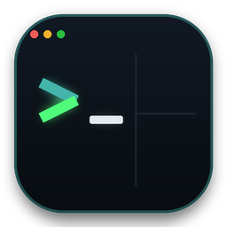
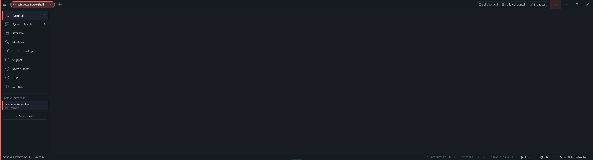

<p align="center">
  
</p>

<h1 align="center">FullTerminal — Debian & Ubuntu Linux Edition</h1>

<p align="center">
  <b>Native Linux Terminal, SSH/SFTP Hub, Kubernetes Switcher, Database & SQL Workspace</b><br>
  <i>Built with Pure C++20, OpenGL Hardware Acceleration, FreeType2/Fontconfig, and Zero Web Bloatware.</i>
</p>

<p align="center">
  
  
  
  
  <a href="https://github.com/geataa/FullTerminal/releases/tag/v1.2.0-debian"></a>
  
</p>

<p align="center">
  
</p>

---

## ⚡ Overview

**FullTerminal (`debian` branch)** is the native **Debian / Ubuntu Linux x64** edition of FullTerminal—a single-binary GPU-accelerated terminal emulator, remote server manager (SSH / SFTP), Kubernetes cluster manager, native database & SQL workspace, and local AI agent workspace. *(Looking for the native Windows Direct2D edition? Switch to the [`main`](https://github.com/geataa/FullTerminal/tree/main) branch or [Windows v1.2.0 release](https://github.com/geataa/FullTerminal/releases/tag/v1.2.0).)*

Engineered in **C++20** with hardware-accelerated **OpenGL (32-bit ARGB GLX)** rendering, **FreeType2 / Fontconfig** crisp subpixel/grayscale text & color emoji typography, and native **POSIX PTY + UNIX socket session persistence**, FullTerminal delivers terminal, infrastructure, database, and multi-agent workflows with zero Electron/Chromium overhead.

---

## 🐧 Supported Distributions & Installation (`v1.2.0-debian`)

### Supported Linux Distributions (`x86_64` / `amd64`)

All heavy client engines (**OpenSSL 3.6.5**, **PostgreSQL `libpq` 18.7**, **MariaDB Connector/C 3.4.11**, **FreeTDS 1.5.21**, **SQLite 3.54.1**, **zlib 1.4**) are **statically compiled** directly into the `fullterminal` binary. Only standard desktop system libraries (`libc6 >= 2.34`, `libstdc++6 >= 12`, `libX11`, `libGL`, `libfreetype`, `libfontconfig`) are dynamically linked:

| Distribution Family | Prebuilt `.deb` & `AppImage` Support | Notes |
| :--- | :--- | :--- |
| **Debian** | **Debian 12 (Bookworm)**, **Debian 13 (Trixie / Sid)** | Ready out of the box (`dpkg` / `apt` or `AppImage`). |
| **Ubuntu** | **Ubuntu 22.04 LTS (Jammy)**, **Ubuntu 24.04 LTS (Noble)** and newer | Ready out of the box on GNOME (Mutter X11 & XWayland), KDE, XFCE. |
| **Debian / Ubuntu Derivatives** | **Linux Mint 21 / 22**, **LMDE 6**, **Pop!_OS 22.04+**, **Pardus 23+**, **Kali Linux**, **Zorin OS 17+** | Full `.deb` and `AppImage` compatibility across Cinnamon, MATE, XFCE, GNOME, KDE. |
| **Debian 11 (Bullseye) & older** | Build from source (`make -j$(nproc)`) | Prebuilt binary requires `GLIBC_2.34+`; source code compiles cleanly on older toolchains. |

### Option 1 — Install Native `.deb` Package (Recommended for Debian / Ubuntu)

Download [`fullterminal_1.2.0_amd64.deb`](https://github.com/geataa/FullTerminal/releases/tag/v1.2.0-debian) and install via `apt`:

```bash
sudo apt install ./fullterminal_1.2.0_amd64.deb
```

Installs `/usr/bin/fullterminal`, application menu launcher (`fullterminal.desktop`), and multi-resolution HiDPI icons. User settings, hosts, K8s configs, and encrypted secrets live in `~/.config/fullterminal/`.

### Option 2 — Click-to-Run Single-File `AppImage`

Download [`FullTerminal-1.2.0-x86_64.AppImage`](https://github.com/geataa/FullTerminal/releases/tag/v1.2.0-debian), mark it executable, and launch directly:

```bash
chmod +x FullTerminal-1.2.0-x86_64.AppImage
./FullTerminal-1.2.0-x86_64.AppImage
```

> [!TIP]
> **Portable AppImage Mode**: Create a `portable_data` folder next to `FullTerminal-1.2.0-x86_64.AppImage` (or set `FULLTERMINAL_PORTABLE=1`) to store all configuration, sessions, and databases locally beside the AppImage instead of `~/.config/fullterminal`.

### Option 3 — Portable Tarball (`FullTerminal-1.2.0-linux-x64-portable.tar.gz`)

```bash
tar -xzf FullTerminal-1.2.0-linux-x64-portable.tar.gz
cd FullTerminal-portable
./FullTerminal
```

Read the full [Debian / Linux v1.2.0 Release Notes](docs/releases/v1.2.0-debian.md) for verification details and artifact checksums.

---

## What's new in 1.2.0 (Debian / Linux Edition)

* **32-Bit ARGB OpenGL Desktop Transparency & Fontconfig Typography**: Real compositor alpha transparency (**10% – 100%**) across normal, maximized, and Visor windows (keeping text, cursor, SFTP panels, and modals crisp), paired with automatic Fontconfig UI/monospace font discovery (`Ubuntu` → `Cantarell` → `Noto Sans` → `DejaVu Sans`) and **Noto Color Emoji** fallback.
* **Quake / Visor Console with XInput2 Global Shortcuts & Parametric Focus Auto-Hide**: Summon FullTerminal from any desktop window via single-key (`F12`), modifier+key, or **2-key global hotkeys** (including full **Turkish Q** and international XKB layout support), resize smoothly without flicker, and toggle **Auto-hide when focus is lost** (`On (Auto-hide)` vs. `Off (Stay pinned)`) in **Settings → Visor**, **Settings → Application**, or the **Slide Drawer**.
* **Herdr BSP Split Panes with Tab Title Preservation**: Split tabs vertically (`Ctrl+Shift+D`) or horizontally (`Ctrl+Shift+E`) while preserving your assigned custom tab title (and primary tab name) across pane splits, focus switches, pane closures, and session restarts.
* **Kubernetes Multi-YAML Import & Per-Tab `KUBECONFIG` Isolation**: Import multiple kubeconfig `.yaml`/`.yml` files at once (`zenity` / `kdialog` native dialog), browse dozens of clusters with a scrollable popup menu, export **only the selected active YAML file** per terminal, and preserve each tab's own active `KUBECONFIG` independently across pane splits, GUI restarts, and reboots without mixing clusters across tabs.
* **Persistent SFTP, Background PTY Daemon & Launch on Startup (`--startup`)**: Interactive OpenSSH `sftp` sessions with 30-second directory caching, clickable column sorting (`▲` / `▼`), `+ File` / `+ Folder` creation, and live upload progress HUD; background `fullterminal --daemon` UNIX socket session survival with automatic stale-socket recovery; and XDG **Launch on Startup** (`~/.config/autostart/fullterminal.desktop`) localized across all 16 languages.
* **Statically Linked Native Database & SQL Workspaces**: Embedded **SQLite 3.54.1**, **PostgreSQL `libpq` 18.7**, **MariaDB Connector/C 3.4.11**, **FreeTDS 1.5.21**, **OpenSSL 3.6.5**, and **zlib 1.4** with a 4-mode TLS selector (**Auto / Prefer**, **Disabled**, **Require (Self-signed)**, **Verify CA**), default PostgreSQL database fallback, live schema filtering, and in-place database switching.

## Development story: Claude → Antigravity → Codex

FullTerminal is proudly built through **Vibe Coding**—a pair-programming collaboration between human engineering direction and frontier AI:

* **Human Vision & Direction**: System architecture, UI/UX ergonomics, feature specifications, and real-time Linux & Windows debugging led by **[@geataa](https://github.com/geataa)**.
* **Initial architecture — [Claude](https://github.com/claude)**: Claude established the project's initial architecture and technical foundation.
* **Continued development & Debian/Linux 1.2.0 Port — Antigravity**: Antigravity built on that architecture, delivered the **1.2.0** persistent SFTP engine, upload HUD, startup integration, Visor 2-key hotkeys, and engineered the native Debian/Ubuntu X11/OpenGL/POSIX PTY edition, 32-bit ARGB transparency, XInput2 global hotkeys, K8s active-cluster workflow, and `.deb`/`AppImage` packaging.
* **1.1.x engineering — OpenAI Codex**: Codex reviewed the architecture, fixed terminal/theme, SSH, SFTP and session bugs, and added the native database and SQL workspace alongside expanded regression tests.

### 🛠️ Work in Progress & Active Polish
FullTerminal was built rapidly and passionately. While the core engines are backed by deterministic automated tests (18 C++20 Linux test suites + HTTP MCP integration tests), **not every single Linux window manager or Wayland/X11 combination has been battle-tested yet**. If you spot anything strange, please open an issue or drop us feedback!

---

## 🌟 Key Features

### 🚀 OpenGL GPU Text Rendering Engine
* **Hardware-Accelerated**: OpenGL 3.3+ & GLX 32-bit ARGB pipeline with FreeType2 + Fontconfig glyph shaping, color emoji rendering, and dock-aware borderless window management (`_NET_WORKAREA` / `_GTK_WORKAREAS_D*`).
* **Standards Compliant**: VT100 / VT220 / xterm-256color and truecolor (24-bit RGB) ANSI support.
* **Semantic Shell Integration (OSC 133)**: Recognizes command boundaries, execution status, and enables instant semantic navigation (`Ctrl+Shift+Up` / `Down`).
* **Interactive Hyperlinks (OSC 8)**: Autodetects URLs and supports explicit OSC 8 links (`Ctrl+Click` to open via `xdg-open`).

### 🪟 Dynamic Tiling Split Panes (Herdr Architecture)
* Split any terminal tab vertically (`Ctrl+Shift+D`) or horizontally (`Ctrl+Shift+E`).
* Re-tile, zoom any pane to full-canvas (`Ctrl+Shift+Z`), and switch focus smoothly (`Ctrl+Alt+Arrows`).
* Tab-level custom title preservation: renaming a tab (`Double-Click Tab` or right-click → **Rename Tab**) keeps its title intact across splits, pane focus changes, and restarts.

### 👻 Desktop Transparency & Opacity Control
* Adjustable terminal canvas opacity from **10% to 100%** in normal, maximized, and Quake/Visor windows via 32-bit ARGB GLX visuals. Text and the cursor remain crisp and opaque.
* Smart overlay isolation: SFTP screens, settings modals, and dialogs remain opaque and readable while terminal viewports blend over the desktop.

### 🎮 Quake / Visor Drop-Down Console & Launch on Startup
* Summon and dismiss FullTerminal from the top of the monitor using a single-key, modifier+key, or **2-key global hotkey** (default: `F12`, powered by XInput2 raw key events).
* Flicker-free interactive bottom-edge resizing and parametric **Auto-hide when focus is lost** (`On` / `Off`).
* Optional **Launch on Startup** (`Settings → Application` or Slide Drawer) writes `~/.config/autostart/fullterminal.desktop` (`--startup`) to start quietly at desktop login.

### 🌐 SSH Infrastructure Hub & Stage Loading
* Visual SSH host inventory with jump host (`ProxyJump`) support, tag filtering, and identity management.
* Native OpenSSH integration supporting **HMAC-SHA1 `HashKnownHosts`** verification (`|1|salt|hash` entries standard on Debian/Ubuntu `~/.ssh/known_hosts`).

### 📁 Dual-Pane SFTP File Explorer
* Persistent interactive SFTP session per host with 30-second directory caching for instant folder navigation without repeated SSH handshakes.
* Native external file upload (`📤 Upload...` via `zenity`/`kdialog` or drag-and-drop) with live **Transfer HUD Banner**, clickable column sorting (`▲` / `▼`), `+ File` / `+ Folder` modals, and full keyboard navigation (`Arrows`, `Enter`, `Backspace`, `Tab`, `F2`, `Del`, `F5`).

### ☸️ Kubernetes Cluster Switcher & Snippets
* Import single or multiple kubeconfig `.yaml`/`.yml` files into `~/.config/fullterminal/k8s/`, switch active clusters from a scrollable right-click menu or Kubernetes view, and automatically or manually export `KUBECONFIG` for **only the selected active cluster** into local shells.
* 1-click `kubectl apply -f -` snippet streaming directly into the active cluster terminal.

### 🗄️ Databases and SQL Workspaces
* Open **Databases** in the sidebar or **+ → Databases / SQL**. Each main tab owns one connection; table views and SQL scripts open as child tabs.
* **SQLite 3.54.1**, **PostgreSQL (`libpq` 18.7)**, **MySQL / MariaDB (`Connector/C` 3.4.11)**, and **SQL Server (`FreeTDS` 1.5.21)** are statically compiled into `fullterminal` alongside **OpenSSL 3.6.5** and **zlib 1.4**—no external database `.so` packages required.
* **4-mode TLS selector** (**Auto / Prefer**, **Disabled**, **Require (Self-signed)**, **Verify CA**), automatic default PostgreSQL database resolution, live schema filter, in-place database switching, SQL editor (`F5` / `Ctrl+Enter` / `Esc`), parameterized table CRUD with savepoints, and CSV/JSON/chart export.

### 🔄 Persistent Background PTY Daemon & Session Recording
* Enable **Settings → Restore sessions** to keep shells alive in `fullterminal --daemon` over an authenticated UNIX domain socket (`session.sock`, `0600`) when the GUI closes, replaying up to **256 KiB** of recent output upon reopening.
* Record live sessions to `.ftrec` or Asciinema v2 `.cast` files and replay with 0.25×–4× speed control (`fullterminal --replay recording.cast`).

### 🤖 Model Context Protocol (MCP) Bridge & 16-Language i18n
* Exposes **11 MCP tools** over stdio (`--mcp`) and authenticated loopback Streamable HTTP (`http://127.0.0.1:8787/mcp` / `--mcp-http`), paired with the live **Agent Approval Ribbon** (`Ctrl+Shift+Y` / `Ctrl+Shift+N`).
* Instant 1-click switching across **16 languages** (English, Turkish, German, French, Spanish, Italian, Portuguese, Dutch, Polish, Hindi, Russian, Ukrainian, Japanese, Korean, Simplified Chinese, Arabic).

---

## 💡 Open Source Inspirations

FullTerminal was deeply inspired by the pioneers of modern, open-source terminal engineering:

* **[Alacritty](https://github.com/alacritty/alacritty)** *(Apache-2.0)* — Raw GPU acceleration and minimal latency.
* **[WezTerm](https://github.com/wez/wezterm)** *(MIT)* — Rich terminal multiplexing, font shaping, and configuration.
* **[Windows Terminal](https://github.com/microsoft/terminal)** *(MIT)* — Modern terminal architecture and session ergonomics.
* **[Kitty](https://github.com/kovidgoyal/kitty)** *(GPL-3.0)* — Modern graphics protocols, keyboard handling, and speed.
* **[Ghostty](https://github.com/ghostty-org/ghostty)** *(MIT)* — Native UI elegance and multi-platform polish.

---

## ⌨️ Essential Keyboard Shortcuts

| Shortcut | Action |
| :--- | :--- |
| `Ctrl + Shift + T` | Open new tab (Default Profile) |
| `Ctrl + Shift + W` | Close active pane or active tab |
| `Ctrl + Shift + D` | Split active tab vertically |
| `Ctrl + Shift + E` | Split active tab horizontally |
| `Ctrl + Shift + Z` | Toggle pane zoom (maximize active pane) |
| `Ctrl + Alt + Arrows` | Cycle focus between split panes |
| `Ctrl + Shift + I` | Toggle Broadcast Input Mode (all panes) |
| `Ctrl + Shift + M` | Toggle quick slide drawer |
| `Ctrl + Left / Right` | Jump cursor backward / forward by word in shell & editors |
| `Alt + Left / Right` | Jump cursor backward / forward by word |
| `Ctrl + Backspace / Delete` | Delete previous / next word in shell (`bash`, `zsh`, `fish`) & editors |
| `Ctrl + /` | Undo in `bash` / `zsh` readline (`^_`) |
| `Ctrl + Insert` / `Shift + Insert` | Copy selection / Paste from clipboard |
| `Ctrl + +` / `Ctrl + -` / `Ctrl + 0` | Zoom terminal font in / out / reset (`11 pt`) |
| `Shift + PageUp / PageDown` | Scroll terminal history up / down by page |
| `Shift + Home / End` | Jump to top / bottom of terminal scrollback |
| `Ctrl + Shift + C` | Copy selection to clipboard |
| `Ctrl + Shift + V` | Paste from clipboard with safety strip |
| `Ctrl + Shift + B` | Toggle collapsible sidebar |
| `Ctrl + Shift + H` | Switch to SSH Hosts screen |
| `Ctrl + Shift + S` | Switch to Settings screen |
| `Ctrl + Shift + R` | Start / Stop terminal session recording |
| `Ctrl + Shift + Up / Down` | Jump to previous / next command prompt (OSC 133) |
| `F12` | Toggle Quake / Visor console drop-down |
| `Ctrl + Tab` / `Ctrl + Shift + Tab` | Next / Previous tab |
| `Double-Click Tab` | Rename tab (preserved across pane splits) |
| `Double-Click Terminal Text` | Select and copy whitespace-delimited token |

---

## 🔨 Building & Packaging from Source (Debian / Ubuntu)

### Prerequisites

On **Debian 12+** or **Ubuntu 22.04+**:

```bash
sudo apt-get update
sudo apt-get install -y \
  build-essential pkg-config cmake bison flex m4 perl \
  libx11-dev libxi-dev libgl1-mesa-dev libfreetype6-dev libfontconfig1-dev \
  python3 python3-pil curl file libfuse2 openssh-client
```

### Build Binary, Packages & Run Automated Tests

```bash
# 1. Build static native DB/TLS clients (vendored in vendor/native/) + fullterminal binary + AppImage
make -j$(nproc)

# 2. Run all 18 C++20 automated suites + MCP HTTP integration test (isolated data & runtime dirs)
make -j$(nproc) test

# 3. Build Debian (.deb) installer, AppImage, Portable tarball, and SHA256SUMS.txt into dist/
make release
```

Build outputs:
* `build/fullterminal` — Native `x86_64` executable
* `build/fullterminal_1.2.0_amd64.deb` & `dist/fullterminal_1.2.0_amd64.deb` — Debian / Ubuntu `.deb` package
* `build/FullTerminal-1.2.0-x86_64.AppImage` & `dist/FullTerminal-1.2.0-x86_64.AppImage` — Click-to-run standalone AppImage
* `dist/FullTerminal-1.2.0-linux-x64-portable.tar.gz` — Portable folder archive
* `dist/SHA256SUMS.txt` — SHA-256 checksums

---

## 🎮 Also From geataa on Steam

> By day, I work full-time as a software engineer. Evenings and weekends are dedicated to my passion for indie game development. In the spare moments left over from crafting games, I build tailored, ultra-lightweight native tools like FullTerminal through modern **vibe coding** with AI.
>
> When I'm not writing native tools, check out the game worlds I'm bringing to life on Steam:

<div align="center">

### 🧗 [BouncyClimb](https://store.steampowered.com/app/4787630/)
*A high-octane, physics-defying multiplayer climbing and platforming adventure! Race against your friends, scale hazardous heights, and master the bounce.*

[](https://store.steampowered.com/app/4787630/)

---

### 🍸 [Neon Angora](https://store.steampowered.com/app/4447940/)
*A groundbreaking social simulation and nightclub roleplaying experience powered by Local LLM AI. No canned dialogue trees—speak your mind, influence dynamic NPCs, uncover secrets, and experience a living story that reacts to who you choose to be.*

[](https://store.steampowered.com/app/4447940/)

</div>

---

## 📄 License

FullTerminal is distributed under the **[MIT License](LICENSE)**. You are completely free to use, modify, distribute, and integrate it into private or commercial environments.

<p align="center">
  Crafted with passion, C++20, and Vibe Coding by <b>geataa</b>.
</p>
